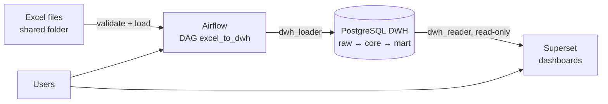

# data-platform-stack

A small, reproducible analytics platform: **Excel files → Apache Airflow → PostgreSQL data warehouse → Apache Superset**.

Two ways to run it, from the same code:

| | Folder | Use it for |
|---|---|---|
| Local demo | [`stand/`](stand/) | Docker Compose on a laptop or WSL. Fastest way to see it work and to develop DAGs. |
| Deployment | [`ansible/`](ansible/) | Ansible roles that deploy the platform to one or several Linux hosts. |

## Architecture



- **DWH layers:** `raw` (data exactly as received, with source file and row number) → `core` (validated) → `mart` (views for reports).
- **Least privilege:** Airflow writes with `dwh_loader`; Superset reads `core` and `mart` only, with `dwh_reader`.
- **Separate metadata databases:** Airflow and Superset each have their own PostgreSQL instance, not the warehouse.
- **Bad files are rejected, not half-loaded:** a file with invalid rows is moved to `rejected/` and the log table names the Excel rows to fix. Re-loading a file replaces its earlier rows (idempotent).

## Quick start (local demo)

Requires Docker with Compose v2.

```bash
cd stand
cp .env.example .env            # then replace every change_me_* value
docker compose up -d --build
```

| Service | URL |
|---|---|
| Airflow | http://localhost:8081 |
| Superset | http://localhost:8088 |

Create sample files and run the DAG:

```bash
python3 -m venv .venv && source .venv/bin/activate
pip install pandas openpyxl
python scripts/make_sample_xlsx.py
```

Enable and trigger `excel_to_dwh` in Airflow, then check the result:

```bash
docker compose exec postgres psql -U postgres -d dwh -c "SELECT * FROM raw.load_log;"
docker compose exec postgres psql -U postgres -d dwh -c "SELECT * FROM mart.sales_by_branch_month;"
```

To connect Superset to the warehouse use `postgresql+psycopg2://dwh_reader:<password>@postgres:5432/dwh`.
More detail in [`stand/README.md`](stand/README.md) (in Russian).

## Deploy with Ansible

```bash
cd ansible
ansible-galaxy collection install -r requirements.yml

cp group_vars/all/vault.yml.example group_vars/all/vault.yml
# edit the secrets, then encrypt them
ansible-vault encrypt group_vars/all/vault.yml

# single machine (default inventory: localhost)
ansible-playbook site.yml --ask-vault-pass

# several hosts
cp inventory/hosts.example.ini inventory/hosts.ini
ansible-playbook -i inventory/hosts.ini site.yml --ask-vault-pass
```

Roles: `common` (Docker check, shared network), `postgres_dwh`, `airflow`, `superset`, `nginx` (optional TLS reverse proxy; enable with `nginx_enabled: true`). Run a single part with tags, e.g. `--tags airflow`. Each service is its own Compose project under `/opt/data-platform/`. Airflow and Superset Dockerfiles and the DAG code are taken from `stand/`, so there is one source of truth.

## Designed for restricted corporate networks

- `image_registry` points every image at an internal registry mirror (Harbor, Nexus, Artifactory); the Dockerfiles accept the same prefix as a build argument.
- Secrets live in Ansible Vault, never in plain text in the repository; `.env` files on hosts are mode `0600`.
- Services are published on `127.0.0.1` by default and reached through the optional nginx proxy with TLS.
- No outbound internet access is needed at runtime once images and Python packages are mirrored internally.
- `docs/questions-it-ib.md` is a checklist of questions to settle with infrastructure and security teams before a rollout (in Russian).

## Status

| Part | State |
|---|---|
| `stand/` (Docker Compose) | Run on WSL: the DAG loads a valid file and rejects an invalid one, and Superset connects to the warehouse with a dataset on the mart view |
| `ansible/` roles | Pass `ansible-playbook --syntax-check` and `ansible-lint`; templates render and pass `docker compose config`. Full deployment against a real host is the next thing to verify |

## Roadmap

- Run the playbook end to end on a test VM and record the result here.
- CI: GitHub Actions running `ansible-lint` and `docker compose config` on every push.
- PostgreSQL backups (pgBackRest) and a restore check.
- LDAP/AD login for Airflow and Superset.
- Monitoring and DAG-failure alerts.

## Repository layout

```
.
├── ansible/        site.yml, roles/, inventory/, group_vars/
├── stand/          docker-compose.yml, postgres/init, airflow/, superset/, scripts/
└── docs/           notes and checklists
```
